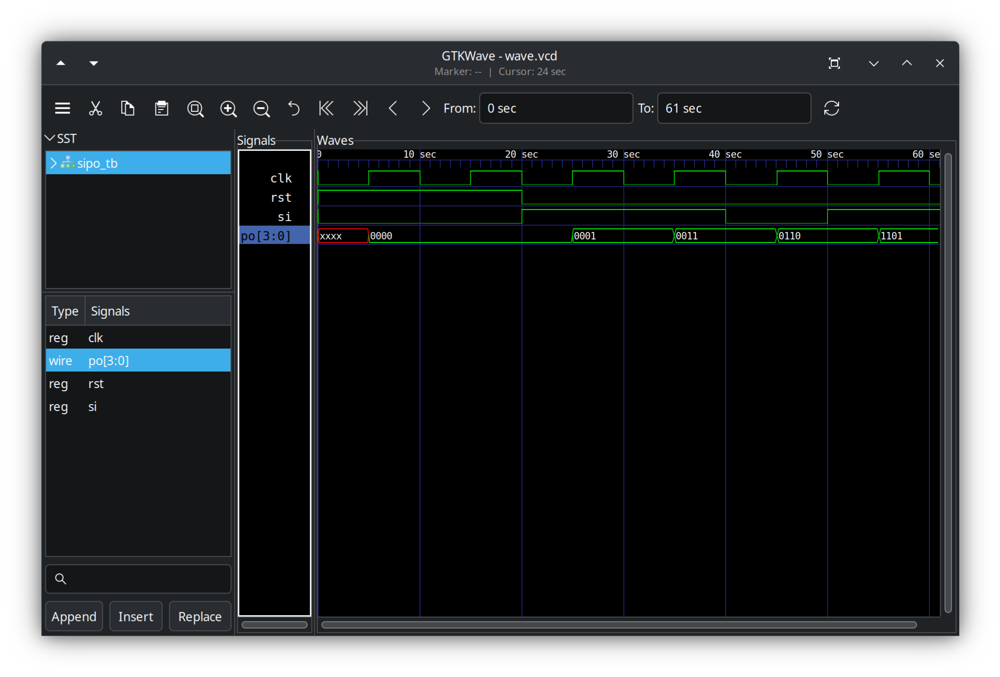

# 4-bit SIPO Shift Register

A 4-bit **Serial-In Parallel-Out (SIPO) shift register** implemented in Verilog.

## Overview

The design accepts one serial input bit on each rising edge of the clock and shifts the stored data through a 4-bit register. After four clock cycles, the accumulated data is available simultaneously on the 4-bit parallel output.

## RTL design

- `clk` — clock input
- `rst` — synchronous, active-high reset
- `si` — serial data input
- `po[3:0]` — 4-bit parallel output

On each rising clock edge:
- If reset is asserted, the output is cleared to `0000`.
- Otherwise, the register shifts left and loads the new serial bit at the least-significant bit:

```verilog
po <= {po[2:0], si};
```

## Verification

The testbench applies the serial sequence:

`1 → 1 → 0 → 1`

Expected output after each capture:

| Capture | Serial input | Parallel output |
|---:|:---:|:---:|
| 1 | 1 | `0001` |
| 2 | 1 | `0011` |
| 3 | 0 | `0110` |
| 4 | 1 | `1101` |

**Expected final output:** `1101`

The testbench generates a clock, applies reset and stimulus on falling clock edges to avoid racing the DUT's rising-edge sampling, monitors signals, dumps a VCD waveform, and checks the final output with case inequality (`!==`).

## Simulation waveform



## Tools

- **HDL:** Verilog
- **OS:** Ubuntu Linux
- **Editor:** Visual Studio Code
- **Simulator:** Icarus Verilog
- **Waveform viewer:** GTKWave
- **Version control:** Git and GitHub

## Linux development milestone

This is my **first RTL project developed entirely on Linux (Ubuntu), without using Windows**. It marks the start of my Linux-based, open-source RTL development workflow.

## Run the simulation

From the project directory:

```bash
iverilog -o sim sipo.v sipo_tb.v
vvp sim
gtkwave wave.vcd
```

The waveform is generated by the testbench using `$dumpfile("wave.vcd")` and `$dumpvars`.

## Project structure

```text
.
├── sipo.v
├── sipo_tb.v
├── wave.png
└── README.md
```
